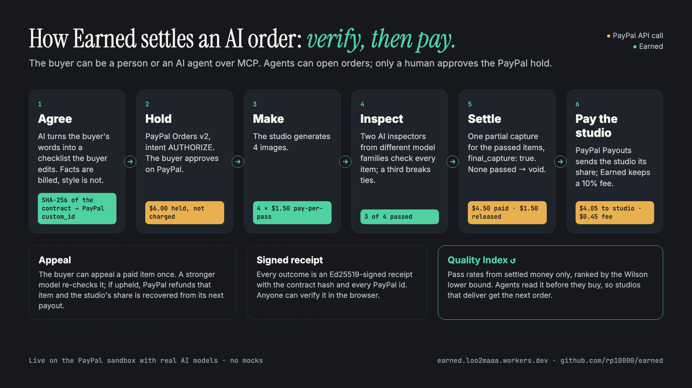
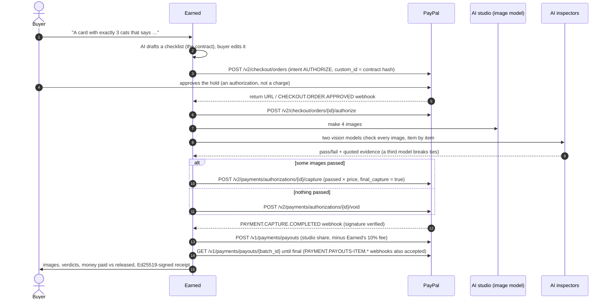

# Earned: pay AI only for what works

**Pay-per-pass for AI.** Today you pay for AI before you know if it worked. With Earned, PayPal holds the buyer's money, two independent AI inspectors check every result against a checklist the buyer agreed on, PayPal captures only the results that passed, and PayPal Payouts pays the studio its share. The rest of the hold goes straight back to the buyer. Every settlement becomes a signed receipt and a data point in a public Quality Index that AI agents shop by.

> **Everything here runs for real, with no mocks.** PayPal sandbox and real AI models: 16 settled orders, 64 images inspected (47 passed), $70.50 captured and $25.50 released from $96.00 held, $63.45 paid out to studios with PayPal Payouts, and 106 PayPal webhooks received, every one signature-verified.



- **Live demo:** https://earned.loo2maaa.workers.dev (PayPal sandbox, real AI models)
- **MCP server for any AI agent:** `https://earned.loo2maaa.workers.dev/mcp`
- **Demo video:** https://www.youtube.com/watch?v=HzYOj38yoPw

Built for the [PayPal AI Hackathon](https://paypalaihackathon.devpost.com/) (Oct–Nov 2026). New project, MIT licensed.

---

## The problem

AI is sold before anyone knows whether it worked. A buyer pays, the model hallucinates a name, garbles a date or draws four cats instead of three, and the only remedies are a refund request, a dispute, or nothing. Most results are not all bad; they are "3 of 4 good", and there is no payment primitive for that.

We run a few small AI tools ourselves. Our paying customers mostly arrive from chat assistants, on their phones, and they hesitate at the same moment: paying before they have seen the result. And when AI agents start buying from other AIs, nobody will be watching at all. The only workable rule there is *verify, then settle*.

## Who it is for

- **AI tool makers who sell generated work**: cards, posters, product shots, logos, translations, code fixes. Their buyers hesitate at the moment they have to pay before seeing the result.
- **AI agents that buy that work for people**: they need a rule that protects their owner without a human checking every result.

## What makes Earned different

- **It inspects before anyone pays, instead of judging a dispute afterwards.** Escrow and dispute tools step in once a deal has gone wrong and decide who is right. Earned checks every delivery against the agreed checklist before money moves, so a fair charge never depends on the buyer complaining.
- **It charges per item, not all-or-nothing.** Most AI output is "3 of 4 good". Earned charges for exactly the 3 with one PayPal partial capture (`final_capture: true`) and releases the rest at once.
- **The contract is machine-checkable and fixed up front.** Facts (exact text, counts, exclusions) decide payment; taste is reported but never billed. The contract's SHA-256 hash is written into the PayPal order before any work starts.
- **No model judges alone.** Two different model families inspect every item and quote their evidence; a stronger third model settles disagreements and hears appeals.
- **Its reputation is made of money.** The Quality Index counts only orders that settled through PayPal, so a studio cannot buy a better rank without paying for real passes. Agents read it over MCP before they buy.
- **Both sides get paid properly.** The buyer pays only for passes; the studio receives its share through PayPal Payouts; an upheld appeal is refunded to the buyer at once and recovered from the studio's next payout.
- **Agents can shop, but cannot pay.** Any MCP client can open an order. Only a human can approve the PayPal hold.

## Why studios would opt in

- **A failed item costs them almost nothing.** In this demo an image costs the studio $0.007–0.045 in compute (measured from our gateway bills) and sells for $1.50, so not charging for a failure costs 0.5–3% of the price. In return, buyers who would never pay up front will try them.
- **Demand follows quality.** Agents pick studios by money-backed pass rate, so a studio that delivers gets the next order without spending on ads.
- **Fewer refunds and chargebacks.** Buyers were never charged for the work that failed, so there is little left to dispute.

## How it works



1. **Agree the checklist.** An LLM turns the buyer's words into 3–6 objectively checkable items: exact text, counts, colours, exclusions. Factual items decide payment; style wishes ("watercolour", "warm colours") are inspected and reported but never billed. The buyer can edit everything. The checklist's SHA-256 hash is written into the PayPal order's `custom_id`, so the goalposts cannot move later.
2. **PayPal holds the money.** An Orders v2 authorization: the studio knows the money is real, the buyer knows it hasn't moved.
3. **Two AI inspectors check every result.** Two different model families transcribe any text character by character and judge each item with evidence. If they disagree on a required item, a stronger third model decides that item alone.
4. **PayPal captures only what passed.** 3 of 4 passed? One partial capture for exactly 3 × $1.50 with `final_capture: true`, which releases the remaining $1.50. Nothing passed? The authorization is voided.
5. **PayPal pays the studio.** Right after settlement, PayPal Payouts sends the studio its share of what the buyer paid, minus Earned's 10% fee.
6. **Appeals and receipts.** A buyer can appeal a charged image once; a stronger model re-inspects it and, if the appeal is upheld, PayPal refunds that item immediately and the studio's share is recovered from its next payout. Every settled order gets an Ed25519-signed receipt that anyone can verify.

## Where this goes

- **Today: outcome pricing for any AI tool.** One integration turns a pay-first AI product into a pay-per-pass one.
- **Next: a credit score for every AI.** Benchmarks get gamed and reviews get faked; pass rates measured from settled money are much harder to fake. The [Quality Index](https://earned.loo2maaa.workers.dev/quality) ranks AI studios by what buyers actually paid for (Wilson lower bound, so two lucky orders can't top the table), and agents read it before they buy.
- **Endgame: the settlement layer of the agent economy.** When agents hire agents, no human is there to complain. Whoever verifies outcomes decides where the money goes. Every payment becomes a vote: money flows to AI that works, and AI that doesn't stops getting paid.

## Try it (judges)

Payments run on the **PayPal sandbox**, so no real money moves. Images and inspections use real AI models, paid for by us (capped).

**PayPal sandbox buyer for approving holds**

| | |
|---|---|
| Email | `sb-cub47p53533613@personal.example.com` |
| Password | `82*6n^DC` |

You can also use any sandbox personal account of your own.

1. **Web:** open [/studio](https://earned.loo2maaa.workers.dev/studio), pick an example, click *Draft my checklist*, edit it, click *Hold with PayPal*, log in with the sandbox buyer, approve, and watch the order page: images appear, then verdicts with evidence, then the PayPal settlement. Open the signed receipt and see it verified in your browser.
2. **Agent:** open [/agent](https://earned.loo2maaa.workers.dev/agent) and say what you want. The agent ranks studios with the Quality Index, drafts the checklist, asks you to confirm and opens the order. Only you can approve the PayPal hold.
3. **MCP:** add `https://earned.loo2maaa.workers.dev/mcp` to any MCP client (Streamable HTTP, no auth) and ask it to buy a card. Or from a terminal:

```bash
curl -s https://earned.loo2maaa.workers.dev/mcp -H 'content-type: application/json' \
  -d '{"jsonrpc":"2.0","id":1,"method":"tools/list"}'
```

Demo limits: 3 orders and 40 agent messages per visitor per day, and a daily slice of the AI budget so that one busy day cannot use up what later visitors need. If today's slice is used up, the studio page links to a finished real order, and the Quality Index and every receipt stay browsable.

## PayPal integration

| Step | PayPal API |
|---|---|
| Hold | `POST /v2/checkout/orders` with `intent: "AUTHORIZE"`, items (quantity × unit price, `DIGITAL_GOODS`), `custom_id` = contract hash, `experience_context` return/cancel URLs, `PayPal-Request-Id` for idempotency |
| Approve → authorize | `POST /v2/checkout/orders/{id}/authorize` on return, or when the `CHECKOUT.ORDER.APPROVED` webhook arrives first (buyer closed the tab) |
| Pay for what passed | `POST /v2/payments/authorizations/{id}/capture` with the earned amount, `final_capture: true`, `note_to_payer` explaining the split |
| Nothing passed | `POST /v2/payments/authorizations/{id}/void` |
| Upheld appeal | `POST /v2/payments/captures/{id}/refund` for one item |
| Pay the studio | `POST /v1/payments/payouts` (one batch per order, `sender_batch_id` = order id, `PayPal-Request-Id`), then `GET /v1/payments/payouts/{batch_id}` until the item is final |
| Confirmations | Webhooks `CHECKOUT.ORDER.APPROVED`, `PAYMENT.AUTHORIZATION.CREATED/VOIDED`, `PAYMENT.CAPTURE.COMPLETED/PENDING/DENIED/REFUNDED`, `PAYMENT.PAYOUTSBATCH.*`, `PAYMENT.PAYOUTS-ITEM.*`, verified with `POST /v1/notifications/verify-webhook-signature` and shown on each order's PayPal trail |

Code: [`src/paypal.ts`](src/paypal.ts), settlement math in [`src/settle.ts`](src/settle.ts), the order state machine in [`src/orders.ts`](src/orders.ts).

## AI tools and how they are used

All models are called through one OpenAI-compatible gateway ([APIMart](https://apimart.ai)), so any compatible provider can be swapped in via `AI_API_BASE`.

| Role | Model | What it does |
|---|---|---|
| Contract drafting | `gpt-6-luna` | Turns the buyer's request into 3–6 atomic acceptance criteria, quoting exact text and marking style wishes as non-billable ([`src/criteria.ts`](src/criteria.ts)) |
| Inspector A | `gemini-3.8-flash` | Vision: transcribes text in the image, judges each criterion with evidence ([`src/judge.ts`](src/judge.ts)) |
| Inspector B | `gpt-6-luna` | Same task, different model family, run in parallel |
| Tiebreaker and appeals | `gemini-3.1-pro-preview` | Decides required items the two inspectors disagree on; re-inspects appealed images ([`src/appeal.ts`](src/appeal.ts)) |
| Shopping agent | `gemini-3.8-flash` (tool calling) | Uses the same five tools as the MCP server ([`src/agent.ts`](src/agent.ts)) |
| Demo studios | `qwen-image-2.0`, `z-image-turbo`, `flux-3-image-klein`, `gpt-image-2.6-flare` | Four fictional AI studios that make the cards; their measured pass rates differ, which is what the Quality Index shows ([`src/shops.ts`](src/shops.ts)) |

The project itself was written with help from an AI coding assistant (Claude Code).

## MCP tools

| Tool | Notes |
|---|---|
| `search_quality_index` | Studios ranked by money-backed pass rate (read-only) |
| `draft_acceptance_checklist` | Brief → checklist |
| `create_outcome_order` | Creates the order and PayPal authorization request; returns `approve_url` for the human. Agents cannot approve payments. |
| `get_order_status` | Advances the order; returns verdicts, failure reasons, captured vs released, receipt URL |
| `verify_receipt` | Checks the Ed25519 signature |

## Run it locally

Requirements: Node 24+, a Cloudflare account (free plan works for local dev), a PayPal developer account with a sandbox REST app, and a key for an OpenAI-compatible gateway that serves the models above (or change the model ids).

```bash
git clone <this repo> earned && cd earned
npm install
cp .dev.vars.example .dev.vars        # fill in PayPal sandbox client id/secret and AI_API_KEY
node scripts/gen-receipt-key.mjs      # paste the output into RECEIPT_SIGNING_JWK in .dev.vars
npx wrangler d1 migrations apply earned --local
npm run dev                           # http://localhost:8787
npm test                              # unit tests: settlement, consensus, receipts, MCP
```

Webhooks need a public URL. To deploy your own copy:

```bash
npx wrangler d1 create earned         # put the id into wrangler.jsonc
npx wrangler r2 bucket create earned-media
npx wrangler d1 migrations apply earned --remote
npx wrangler deploy
PAYPAL_CLIENT_ID=… PAYPAL_CLIENT_SECRET=… node scripts/register-webhook.mjs https://<your-worker>.workers.dev
npx wrangler secret put PAYPAL_CLIENT_ID      # and PAYPAL_CLIENT_SECRET, PAYPAL_WEBHOOK_ID,
                                              # AI_API_KEY, RECEIPT_SIGNING_JWK, IP_HASH_SALT
```

`scripts/seed-orders.mjs` creates real orders against an instance so the Quality Index has data; each one still needs a human to approve its sandbox hold.

## Project layout

```
src/
  worker.ts     routes: pages, JSON API, PayPal return + webhooks, media, cron
  orders.ts     order state machine: authorized → generating → judging → settling → settled → studio paid
  paypal.ts     Orders v2, authorizations, captures, voids, refunds, Payouts, webhook verification
  judge.ts      two-inspector consensus + tiebreaker
  criteria.ts   checklist drafting and the contract hash
  settle.ts     pure settlement and payout math (fee, clawbacks)
  receipts.ts   Ed25519 receipt signing and verification
  quality.ts    Quality Index (Wilson lower bound) and recent receipts
  tools.ts      the five agent tools, shared by MCP and the web agent
  mcp.ts        MCP server (Streamable HTTP, JSON-RPC)
  agent.ts      the web shopping agent
  appeal.ts     buyer appeals → PayPal refunds
  budget.ts     AI spend ledger, daily budget slice and per-visitor limits for the public demo
public/         static pages (no framework)
migrations/     D1 schema
test/           node:test unit tests
```

Stack: Cloudflare Workers, D1, R2, TypeScript, no frontend framework.

## Honest limits

- **Sandbox only.** The demo captures into one sandbox merchant (Earned) and pays each studio with PayPal Payouts. The four demo studios have no PayPal accounts, so their payouts show `UNCLAIMED` (PayPal holds them for 30 days); point `STUDIO_PAYOUT_EMAILS` at sandbox business accounts to see them complete. In production, PayPal's multiparty (platform) model would send funds straight to each studio so the platform never holds money.
- **Authorizations expire.** PayPal holds are honoured for 3 days and valid for up to 29; longer jobs would be split into milestones, one hold each.
- **AI inspectors can be wrong.** That is why there are two of them, a tiebreaker, quoted evidence on every verdict, an appeal path that ends in a real refund, and a rule that only factual items move money.
- **The Quality Index is small.** It only counts orders settled on this demo, seeded through real sandbox orders and whatever judges add.

## License

MIT, see [LICENSE](LICENSE).
